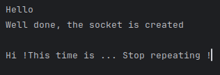
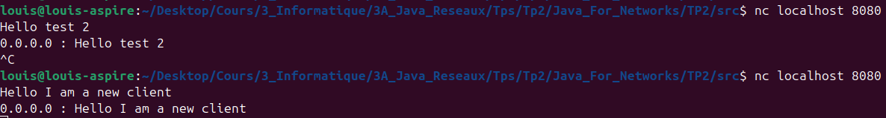
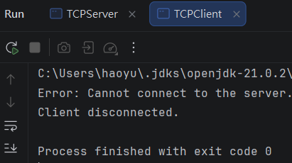
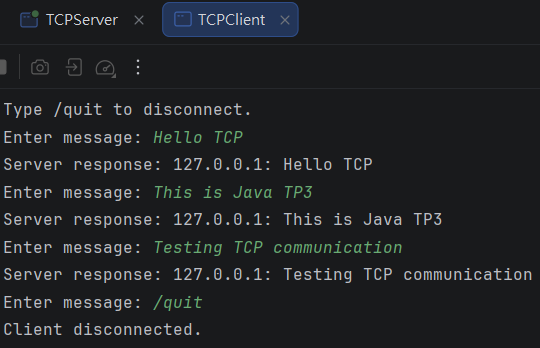
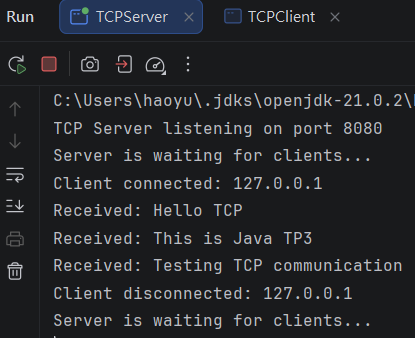
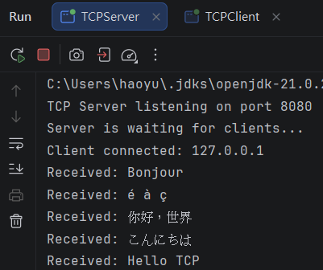
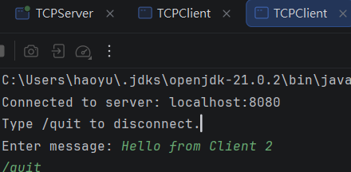
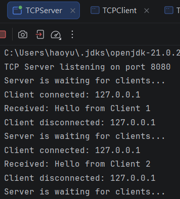

# Java_For_Networks2

## Part 1 
The goal of this part is to create a TCP server that will wait for a client. When a client is connected, it will wait for some message from the client, and when it received some, it "acknowledge" it by retransmit the received message to the client. 

### Step 1 
We generate the bone of the server. 
NB : we added a boolean 'running' that can give us the possibility to start a server that is not running (just in case of)
### Step 2
We create the complete launch function. 

### Step 3
After we finished the TCPServer, we tested it with our terminal.

From the terminal view, we are able to connect ourself to the server and then we can write. The server retransmit what we send to it so at least it seems to work properly. 

From the server view, we have the messages when the socket is created. When a client send a message, the server receive it. 

However, when we tested that the server remains open after the client disconnexion, we found the server send an error. Indeed, we did not manage well the closing of the sockets. After we manage this issue, we have the two following view and when the client leave, the server remains open and wait for another client. 

## Part 2

The goal of this part is to create a TCP client that can connect to the server, send messages and receive responses. We also test error handling, character encoding and multiple client connections.

### Step 4

We create a class named `TCPClient`. The client uses a `Socket` to establish a connection with the server on port 8080. We use `BufferedReader` to receive messages and `PrintWriter` to send messages. Both the client and the server use UTF-8 encoding.

The client reads a message from the keyboard, sends it to the server and waits for the response. When the user enters `/quit`, the client closes the connection.

### Step 5

In this step, we test the error handling of the TCP client.

First, we start the client without starting the server. The client displays an error message because there is no server listening on port 8080.

Then, we start both the client and the server. After establishing a connection, we stop the server and try to send another message from the client.

The client detects the communication failure and displays an error message instead of a Java stack trace.

### Step 6(a)

We send several messages from the client to the server to check whether the communication works correctly.

The server receives the messages and sends them back with the IP address of the client. The client receives the expected responses.

### Step 6(b)

We test messages containing accented characters and characters outside the Latin alphabet, such as French and Chinese characters.

First, both the client and the server use UTF-8 encoding.

The characters are transmitted and displayed correctly.

Then, we change the input encoding of the server from `UTF_8` to `ISO_8859_1` while the client continues to use UTF-8.

English characters are still displayed correctly, but accented characters and Chinese characters are not decoded correctly. This problem is caused by different character encodings, not by packet loss.

After this test, we change the server encoding back to UTF-8.

### Step 7

In this step, we start two TCP clients at the same time to observe how the server handles multiple connections.

The first client connects to the server and receives responses normally.

The second client also establishes a TCP connection, but it does not receive an immediate response after sending a message.

This happens because the operating system can establish the TCP connection even if the Java server has not called `accept()` for the second client.

When the first client disconnects, the server accepts the second client and processes its message.

The server is blocked at the `readLine()` method while waiting for messages from the first client. Since the server uses only one thread, it can only handle one client at a time.

This problem will be solved using multithreading in TP 4.

### Step 8

We stop the client abruptly using the Stop button in IntelliJ IDEA while the server is still running.

The server detects the disconnection, closes the client socket and waits for a new client.

When a TCP connection is closed normally at the transport layer, `readLine()` returns `null`. If the connection is reset, an exception may occur.

We use the following command to check TCP connections on Windows:

`netstat -an | findstr 8080`

The `LISTENING` state means that the server is waiting for new connections. No persistent `CLOSE_WAIT` connection should remain after the client disconnects.

TCP also uses the `TIME_WAIT` state to prevent delayed packets from an old connection from affecting a new connection. It also allows the final ACK to be sent again if necessary.

## Part 3

### Step 9 

In this part, we observe the flow of data between the two interfaces. We use wireshark to observe the traffic of the connection, the exchange of two messages and the disconnect act. 

In this capture we have in total 13 exchange : 

The 3 first and the 3-handshake
- nb 266 : first SYN from the client
- nb 267 : response from the server to the client (SYN + ACK)
- nb 268 : acknowledgment of the client

Then we send the first message
- nb 529 : push of message 1 from the client 
- nb 530 : ACK from the server 
- nb 531 : the server retransmit the data sent and its ip to the client
- nb 532 : ACK from the client 

Then we send the second message
nb 749 - 751 is the same logic except we do not have a second packet for the acknowledgment. Indeed, we notice a mechanism known as : Piggybacking that use the packet 750 an acknowledgment and also send data.

Finally, we have the disconnect act :
- nb 864 : FIN from the client 
- nb 865 : FIN from the serven
- nb 866 : a final ACK that terminate the connection between this server and this client

