# Java_For_Networks2

## Part 1 
The goal of this part is to create a TCP server that will wait for a client. When a client is connected, it will wait for some message from the client, and when it received some, it "acknowledge" it by retransmit the received message to the client. 

### Step 1 
We generate the bone of the server. 
NB : we added a boolean 'running' that can give us the possibility to start a server that is not running (just in case of)
### Step 2
We create the complete launch function. This function is working at two level. Firstly there is the connection with the client. 

### Step 3
After we finished the TCPServer, we tested it with our terminal.

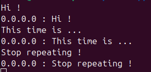

From the terminal view, we are able to connect ourself to the server and then we can write. The server retransmit what we send to it so at least it seems to work properly. 

From the server view, we have the messages when the socket is created. When a client send a message, the server receive it. 

However, when we tested that the server remains open after the client disconnexion, we found the server send an error. Indeed, we did not manage well the closing of the sockets. After we manage this issue, we have the two following view and when the client leave, the server remains open and wait for another client. 

## Part 2

The goal of this part is to create a TCP client that can connect to the server, send messages and receive responses. We also test error handling, character encoding and multiple client connections.

### Step 4

We create a class named `TCPClient`. The client uses a `Socket` to establish a connection with the server on port 8080. We use `BufferedReader` to receive messages and `PrintWriter` to send messages. Both the client and the server use UTF-8 encoding.

The client reads a message from the keyboard, sends it to the server and waits for the response. When the user enters `/quit`, the client closes the connection.

### Step 5

In this step, we test the error handling of the TCP client.

First, we start the client without starting the server. The client displays an error message because there is no server listening on port 8080.

Then, we start both the client and the server. After establishing a connection, we stop the server and try to send another message from the client.

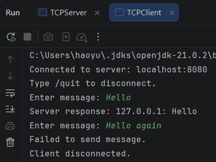

The client detects the communication failure and displays an error message instead of a Java stack trace.

### Step 6(a)

We send several messages from the client to the server to check whether the communication works correctly.

The server receives the messages and sends them back with the IP address of the client. The client receives the expected responses.

### Step 6(b)

We test messages containing accented characters and characters outside the Latin alphabet, such as French and Chinese characters.

First, both the client and the server use UTF-8 encoding.

The characters are transmitted and displayed correctly.

Then, we change the input encoding of the server from `UTF_8` to `ISO_8859_1` while the client continues to use UTF-8.

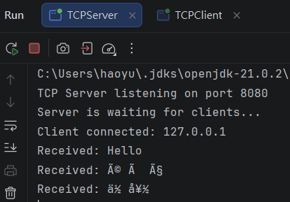

English characters are still displayed correctly, but accented characters and Chinese characters are not decoded correctly. This problem is caused by different character encodings, not by packet loss.

After this test, we change the server encoding back to UTF-8.

### Step 7

In this step, we start two TCP clients at the same time to observe how the server handles multiple connections.

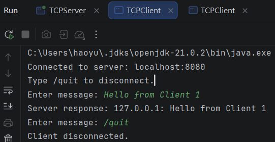

The first client connects to the server and receives responses normally.

The second client also establishes a TCP connection, but it does not receive an immediate response after sending a message.

This happens because the operating system can establish the TCP connection even if the Java server has not called `accept()` for the second client.

When the first client disconnects, the server accepts the second client and processes its message.

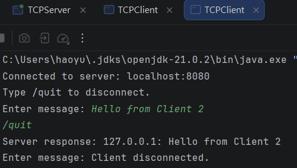

The server is blocked at the `readLine()` method while waiting for messages from the first client. Since the server uses only one thread, it can only handle one client at a time.

This problem will be solved using multithreading in TP 4.

### Step 8

We stop the client abruptly using the Stop button in IntelliJ IDEA while the server is still running.

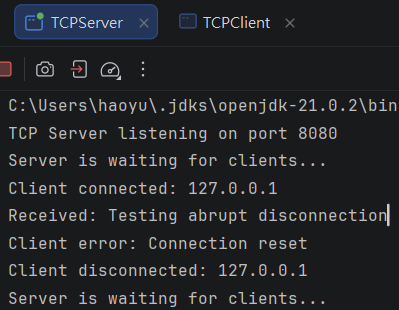

The server detects the disconnection, closes the client socket and waits for a new client.

When a TCP connection is closed normally at the transport layer, `readLine()` returns `null`. If the connection is reset, an exception may occur.

We use the following command to check TCP connections on Windows:

`netstat -an | findstr 8080`

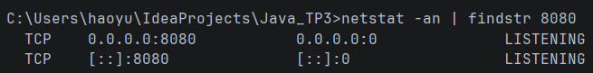

The `LISTENING` state means that the server is waiting for new connections. No persistent `CLOSE_WAIT` connection should remain after the client disconnects.

TCP also uses the `TIME_WAIT` state to prevent delayed packets from an old connection from affecting a new connection. It also allows the final ACK to be sent again if necessary.

## Part 3

### Step 9 

In this part, we observe the flow of data between the two interfaces. We use wireshark to observe the traffic of the connection, the exchange of two messages and the disconnect act. 
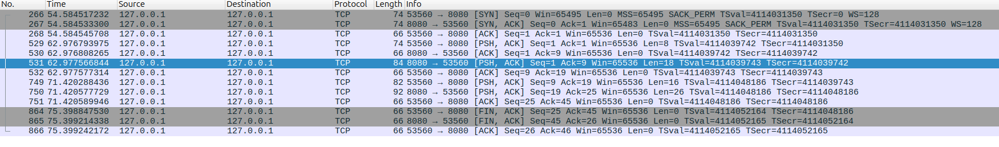
In this capture we have in total 13 exchange : 

The 3 first and the 3-handshake
- nb 266 : first SYN from the client
- nb 267 : response from the server to the client (SYN + ACK)
- nb 268 : acknowledgment of the client

Then we send the first message
- nb 529 : push of message 1 from the client 
- nb 530 : ACK from the server 
- nb 531 : the server retransmit the data sent and its ip to the client
- nb 532 : ACK from the client 

Then we send the second message
nb 749 - 751 is the same logic except we do not have a second packet for the acknowledgment. Indeed, we notice a mechanism known as : Piggybacking that use the packet 750 an acknowledgment and also send data.

Finally, we have the disconnect act :
- nb 864 : FIN from the client 
- nb 865 : FIN from the serven
- nb 866 : a final ACK that terminate the connection between this server and this client

### Step 10

The goal of this step is to understand the difference between TCP byte streams and UDP datagrams.

We create two new classes, `TCPStreamServer` and `TCPStreamClient`, using port 8081. The server uses a buffer of 1024 bytes and waits for one second before reading the data.

**Test 1 - Multiple Short Messages**

The client sends three short messages, `Hello`, `World` and `Java`, using three consecutive `write()` calls without line breaks. The total amount of data sent is 14 bytes.

**Test 2 - One Large Message**

The client sends a block of 10000 bytes using a single `write()` call.

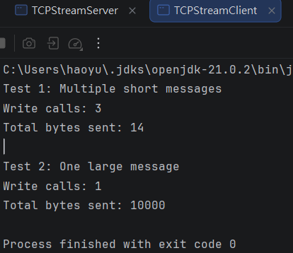

From the client view, the first test uses three write operations, while the second test uses only one write operation.

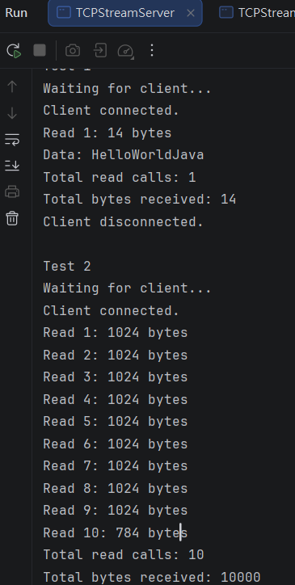

From the server view, we observe that the block of 10000 bytes is received using 10 data-reading operations.

The first nine operations receive 1024 bytes each, and the last operation receives 784 bytes.

`9 x 1024 + 784 = 10000 bytes`

| Test | Write calls | Bytes sent |
|------|------------:|-----------:|
| Multiple short messages | 3 | 14 |
| One large message | 1 | 10000 |

This experiment shows that TCP does not preserve message boundaries. Several write operations can be combined into one read operation, and one large write operation can be divided into several read operations.

In the previous parts, we use `println()` and `readLine()`. The newline character separates different messages and allows the receiver to identify each complete message.

### Step 11

In this step, we compare the behavior of TCP and UDP when the server is not running.

**TCP Error**

We stop the TCP server and try to connect using the TCP client.

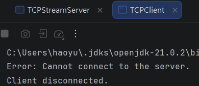

The client displays a connection error because TCP requires a connection before sending messages.

TCP can also detect when the other side closes or resets an existing connection during network operations.

**UDP Error**

We create a new Java class named `UDPErrorTest` to compare an unconnected UDP socket and a connected UDP socket.

We configure a timeout of 3000 milliseconds to avoid waiting indefinitely for a response.

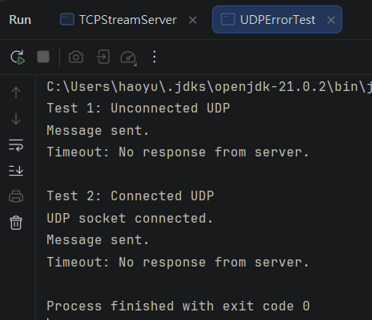

We obtain the following results:

| Test | Message sent | Result |
|------|--------------|--------|
| Unconnected UDP | Yes | Timeout |
| Connected UDP | Yes | Timeout |

In both tests, the client can send a UDP message even when the server is not running. However, no response is received.

Calling `connect()` on a UDP socket does not establish a real connection like TCP. It only specifies the remote IP address and port.

**ICMP Analysis**

We use Wireshark to observe the UDP packets and possible ICMP error messages.

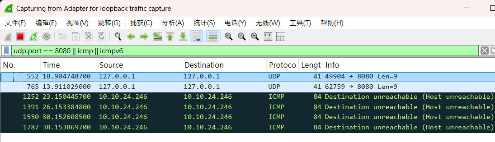

Two UDP packets are sent to port 8080. Each packet contains the message `Hello UDP`, with a payload of 9 bytes.

No ICMP Port Unreachable message related to these two packets is observed in our capture.

A connected UDP socket may report a `PortUnreachableException`, but this behavior is not guaranteed. In our Windows experiment, both UDP tests end with a timeout.

Unlike TCP, UDP has no connection termination mechanism. If the server stops, the UDP client does not automatically receive a disconnection notification.

### Step 12(a)

**Which mechanisms of TCP did we have to re-implement over UDP in TP 2? Which ones did we get for free here?**

In TP 2, we use sequence numbers to identify UDP packets and detect packet loss. To provide reliable communication over UDP, acknowledgments and retransmissions also need to be implemented at the application level.

With TCP, these mechanisms are already provided by the transport layer.

TCP automatically provides sequence numbers, acknowledgments, retransmissions, ordered delivery, flow control and congestion control.

Therefore, we do not need to implement these mechanisms manually in our TCP application.

### Step 12(b)

**For which applications would we choose UDP rather than TCP, and why?**

We would choose UDP for real-time applications such as online gaming, video conferencing, live streaming and VoIP.

These applications require low latency and can tolerate some packet loss. UDP does not require connection establishment and automatic retransmissions, which can reduce delays.

For example, during a video call, it is often better to receive the next video frame than to wait for the retransmission of an old frame.

TCP is more suitable for applications such as file transfers, where reliable and ordered data delivery is important.

## Part 4

The goal of this part is to extend the TCP server with message history and client identification. We create two additional classes, `TCPAdvancedServer` and `TCPAdvancedClient`, using port 8082.

### Step 13

In this step, we implement a message history function. The server uses an `ArrayList` to store the last 10 messages received from all clients.

Each time the server receives a new message, it adds the message to the history. If the number of messages is greater than 10, the oldest message is removed.

First, we connect the first client to the server and send 12 messages.

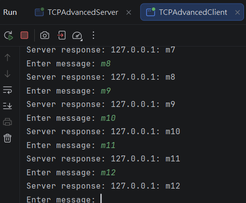

After the first client disconnects, we start a second client.

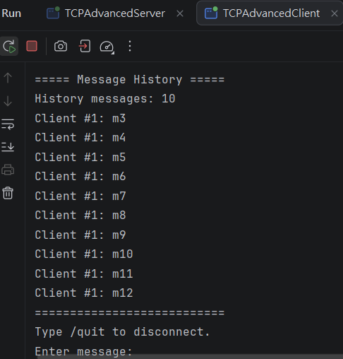

The second client automatically receives the last 10 messages stored by the server. The first two messages are removed from the history.

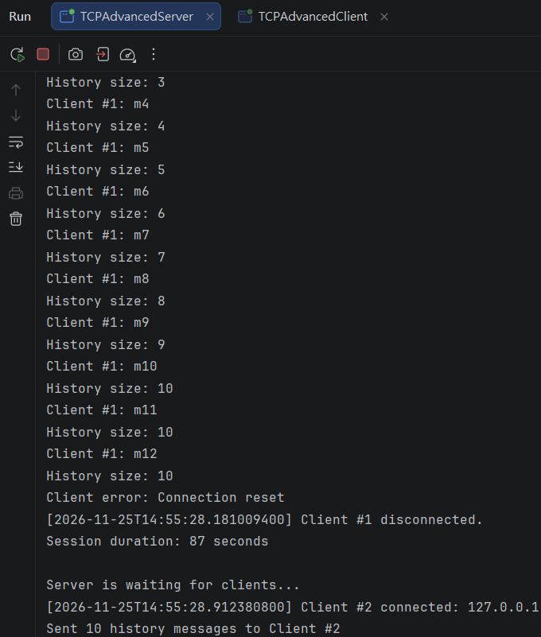

From the server view, we can observe that the history stores a maximum of 10 messages. When a new client connects, the server sends the stored messages before starting normal communication.

**Question: What problem could occur if several threads access the history at the same time?**

If several threads access and modify the same history list at the same time, a race condition may occur.

Some messages may be lost, or the history may become inconsistent. In TP 4, synchronization can be used to protect the shared list and ensure thread safety.

### Step 14

In this step, we implement client identification and session monitoring.

The server assigns a unique ID to each new client during its execution. The ID increases each time a new client is accepted.

We use `LocalDateTime.now()` to record the connection and disconnection timestamps. We also use `Duration.between()` to calculate the duration of each session.

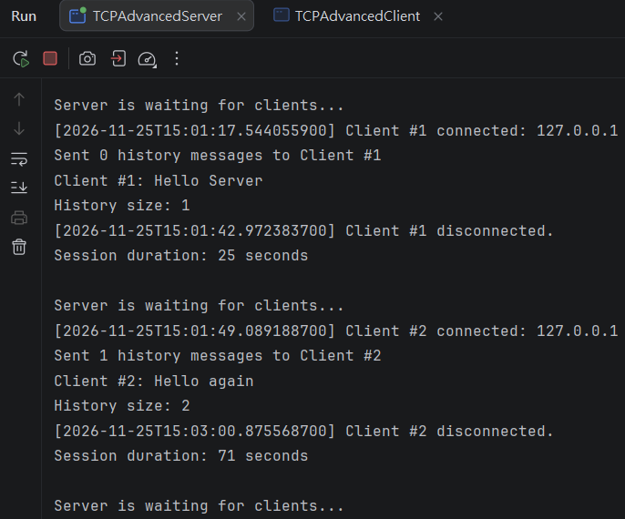

From the server view, we can observe the different client IDs, connection timestamps, disconnection timestamps and session durations.

In our experiment, Client #1 connects to the server and sends the message `Hello Server`. The session lasts 25 seconds.

After Client #1 disconnects, Client #2 connects to the server with a different ID and sends another message.

This function allows the server to identify different clients and monitor their sessions. It will also be useful when implementing a multithreaded TCP server in TP 4.

## Conclusion

In this lab, we implemented a TCP client and server using Java sockets. We tested message transmission, character encoding, error handling, multiple connections and client disconnection.

We also used Wireshark to observe the three-way handshake, data transmission, acknowledgments and connection termination.

By comparing TCP and UDP, we observed that TCP provides reliable and ordered byte-stream communication, while UDP provides connectionless datagram communication with lower protocol overhead.

Finally, we extended the TCP server with message history and client identification.

The current TCP server can only handle one client at a time. In the next lab, we will use multithreading to allow several clients to communicate with the server simultaneously.
